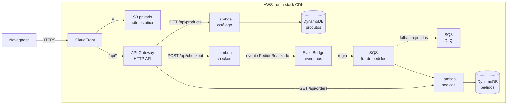

# 🌙 Pijamoon · Commerce serverless na AWS

Loja de pijamas headless publicada na AWS com back-end serverless orientado a eventos e toda a infraestrutura definida como código com AWS CDK.

> 🚧 **Em construção.** O andamento está no [Roadmap](#roadmap). A URL pública e as instruções de deploy entram aqui quando as etapas correspondentes forem concluídas.

## Visão geral

- **Front headless:** site estático em HTML, CSS e TypeScript, que só conversa com o back-end por API.
- **Catálogo síncrono:** o navegador pede os produtos e recebe a resposta na hora.
- **Checkout assíncrono:** o checkout publica um evento e responde na hora. O pedido é criado depois, por outro serviço, a partir de uma fila.
- **Infraestrutura como código:** tudo é criado e removido com o CDK (`cdk deploy` e `cdk destroy`), sem passos manuais no console.

## Arquitetura planejada



Cada serviço tem a sua própria função e a sua própria tabela: o checkout não grava na tabela de pedidos, ele só avisa que um pedido foi feito.

## Roadmap

Cada etapa fecha com algo funcionando e testado. A lista mostra o que já foi feito e o que ainda falta.

### Etapa 0 · Preparação

- [x] Criar a branch do desafio
- [x] Reorganizar o repositório, com o front em `site/`
- [x] Tirar os arquivos das fases anteriores (Supabase e notas do bootcamp)
- [x] Instalar a AWS CLI e o AWS CDK e configurar o acesso à conta

### Etapa 1 · Fundação com CDK

**Conceitos:** App, Stack e Construct · `synth`, `diff`, `deploy` e `destroy` · bootstrap

- [x] Criar o projeto CDK em TypeScript em `infra/`
- [x] Rodar o `cdk bootstrap` na conta e na região
- [x] Fazer o primeiro deploy e o primeiro `destroy` de uma stack simples

### Etapa 2 · Catálogo

**Conceitos:** constructs L2 · `grant*` e menor privilégio · Query em GSI

- [ ] Criar a tabela de produtos com um GSI para listar o catálogo sem Scan
- [ ] Popular a tabela com os 6 produtos no deploy
- [ ] Criar a Lambda do catálogo, com permissão só de leitura
- [ ] Expor `GET /api/products` no API Gateway

### Etapa 3 · Site publicado

**Conceitos:** S3 privado com Origin Access Control · CloudFront com várias origens · deploy do site pelo CDK

- [ ] Criar o bucket privado e a distribuição do CloudFront
- [ ] Encaminhar `/api/*` para o API Gateway, sem cache
- [ ] Publicar o site pelo CDK e abrir a loja pela URL pública

### Etapa 4 · Checkout orientado a eventos

**Conceitos:** síncrono x assíncrono · EventBridge (bus, regra e alvo) · SQS · DLQ · entrega "pelo menos uma vez" · idempotência

- [ ] Criar o event bus e a regra do evento de pedido
- [ ] Criar `POST /api/checkout`: validar o pedido, publicar o evento e responder na hora
- [ ] Criar a fila de pedidos com DLQ
- [ ] Criar a Lambda de pedidos, que lê a fila e grava na tabela de pedidos
- [ ] Garantir que um evento repetido não gere um pedido duplicado
- [ ] Expor `GET /api/orders` para consultar os pedidos

### Etapa 5 · Front integrado

- [ ] Fazer o checkout do site chamar a API e mostrar o número do pedido
- [ ] Mostrar os pedidos do cliente no site
- [ ] Testar o fluxo completo pela URL pública

### Etapa 6 · CI/CD

**Conceitos:** GitHub Actions · OIDC, sem credenciais salvas no GitHub

- [ ] Criar a role de deploy acessada via OIDC
- [ ] Rodar o build e o `cdk deploy` a cada push na `main`

### Etapa 7 · Testes de falha e entrega

- [ ] Forçar um erro na Lambda de pedidos e ver a mensagem chegar na DLQ
- [ ] Atualizar o diagrama com a arquitetura final
- [ ] Documentar como implantar e como remover a stack
- [ ] Conferir se o repositório, a URL e o README estão acessíveis

### Extras, se houver tempo

- [ ] Carrinho no back-end, com serviço e tabela próprios
- [ ] Login real com Amazon Cognito, protegendo as rotas de pedido
- [ ] Alarmes no CloudWatch para erros, mensagens na DLQ e fila parada
- [ ] Ambientes separados de dev e prod

## Estrutura

```
site/       front headless: HTML, CSS e TypeScript (compilado com tsc)
.github/    workflow do GitHub Actions
backend/    código das Lambdas (criado na Etapa 2)
infra/      stack do AWS CDK em TypeScript (criada na Etapa 1)
```

## Rodando o site localmente

```bash
cd site
npm ci
npm run build      # compila site/ts/ para site/js/
```

Depois é só servir a pasta `site/` (por exemplo, com `npx serve site`). As páginas abrem, mas os produtos só carregam quando a API estiver publicada, porque o site busca o catálogo em `/api/products`.

## Como implantar

_Será preenchido na Etapa 7._

## Histórico do projeto

A Pijamoon nasceu no desafio "Minha Loja no Ar" do bootcamp e foi evoluindo neste mesmo repositório:

1. **Site estático** com o catálogo em um arquivo JSON, publicado em S3 + CloudFront.
2. **Catálogo no Supabase**, consultado direto pelo navegador.
3. **Catálogo em uma API na AWS** (API Gateway, Lambda e DynamoDB), com os recursos criados pelo console.
4. **Deploy automático do site** com GitHub Actions e OIDC.
5. **Agora:** toda a infraestrutura em CDK, numa conta AWS nova, com o checkout orientado a eventos.

Os arquivos das fases anteriores (como o SQL do Supabase e as notas da entrega do bootcamp) saíram da pasta do projeto, mas continuam no histórico do Git.
