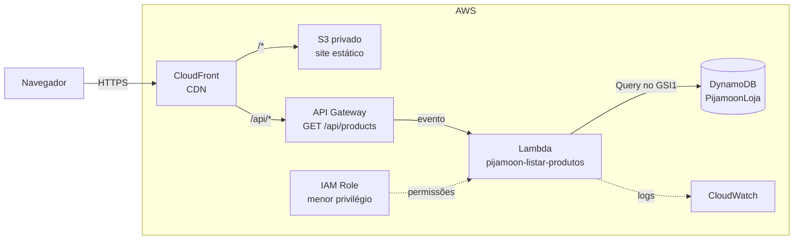

# 🌙 Pijamoon

Loja de pijamas — desafio **"Minha Loja no Ar"** do **AI/R Fellowship**, turma do Bootcamp **"AWS AI FDE for Commerce"**, promovida pela **AIR Academy** e o **Innovation Studio Digital Commerce**, com apoio da **AWS**.

**🔗 Loja no ar:** https://drifd8sm57jac.cloudfront.net

## Sobre

Vitrine de pijamas com catálogo carregado dinamicamente de uma API serverless na AWS (nenhum produto fica hardcodado no HTML), busca e filtro por categoria, hero em carrossel, página de detalhes com tamanhos, carrinho de compras, login e checkout simulados, e modo escuro alternável.

O front é um site estático — HTML, CSS e TypeScript puro, sem framework e sem bundler.

## Funcionalidades

- 🔍 Busca por nome + filtro por categoria
- 🖼️ Hero em carrossel, montado a partir das próprias fotos do catálogo
- 👕 Página de detalhes do produto (fotos de frente/costas, tamanhos, quantidade)
- 🛒 Carrinho de compras persistido no navegador
- 🔐 Login simulado — obrigatório pra finalizar a compra
- 💳 Checkout com endereço de entrega e pagamento simulado (cartão ou Pix)
- 🌗 Modo claro/escuro alternável, salvo por página

> Login, carrinho e checkout são **simulados no navegador** (`localStorage`) — só o catálogo tem backend. Nenhum dado de usuário ou pedido é enviado ou processado.

## Arquitetura

O site e a API são servidos pelo mesmo domínio, então o navegador não precisa de CORS:



| Serviço | Papel |
| --- | --- |
| **CloudFront** | Entrega o site e encaminha `/api/*` para a API, sem cache nessa rota |
| **S3** | Guarda os arquivos do site em um bucket privado, com Origin Access Control |
| **API Gateway** (HTTP API) | Expõe a rota pública `GET /api/products` |
| **Lambda** (Node.js 24) | Consulta o catálogo e devolve os produtos em JSON |
| **DynamoDB** | Guarda os produtos na tabela `PijamoonLoja`, em modo on-demand |

O catálogo é lido com um `Query` no índice `GSI1` (`GSI1PK = CATALOG`), sem `Scan`. A Lambda usa uma IAM Role, sem credenciais no código, e tem permissão apenas para fazer `dynamodb:Query` nesse índice.

> A infraestrutura do backend e o código da Lambda foram criados pelo console da AWS e ainda não estão neste repositório.

## Stack

- HTML, CSS e TypeScript (compilado com `tsc`, sem bundler nem módulos)
- AWS: S3, CloudFront, API Gateway, Lambda, DynamoDB, IAM e CloudWatch

## Rodando localmente

```bash
npm install
npm run build      # compila ts/ para js/
```

Depois é só servir os arquivos estáticos da raiz do projeto (ex: extensão *Live Server* do VS Code, ou `npx serve`) e abrir `index.html`.

> O catálogo é buscado em `/api/products`, um caminho que só existe no CloudFront. Rodando localmente, as páginas abrem, mas os produtos não carregam.

Pra recompilar automaticamente enquanto edita o TypeScript:

```bash
npm run watch
```

## Estrutura

```
index.html            vitrine
produto/index.html    detalhes do produto
login/index.html      login simulado
carrinho/index.html   carrinho
checkout/index.html   endereço + pagamento simulado
como-fiz/index.html   vídeo explicativo do desafio

css/style.css          estilos (tema claro + escuro)
ts/                     código-fonte TypeScript (comentado)
js/                     gerado pelo tsc — não editar à mão
supabase/schema.sql     SQL do catálogo antigo no Supabase (histórico, não é mais usado)
img/produtos/           fotos dos produtos
```

## Mais detalhes

Este projeto é a entrega de um desafio de bootcamp — ver [`PROJETO.md`](PROJETO.md) para o histórico de decisões técnicas da entrega original, feita quando o catálogo ainda estava no Supabase.
