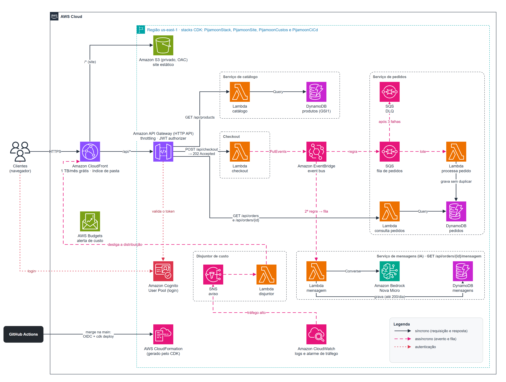

# 🌙 Pijamoon · Commerce serverless na AWS

Loja de pijamas headless publicada na AWS com back-end serverless orientado a eventos e toda a infraestrutura definida como código com AWS CDK.

**🌐 Loja no ar:** https://main.d2g6m9ahoibnw1.amplifyapp.com

> ✅ **Etapas obrigatórias concluídas.** O andamento está no [Roadmap](#roadmap), e as instruções para implantar e remover estão em [Como implantar](#como-implantar).

## Visão geral

- **Front headless:** site estático em HTML, CSS e TypeScript, que só conversa com o back-end por API.
- **Catálogo síncrono:** o navegador pede os produtos e recebe a resposta na hora.
- **Checkout assíncrono:** o checkout publica um evento e responde na hora com `202 Accepted`. O pedido é criado depois, por outro serviço, a partir de uma fila.
- **Infraestrutura como código:** tudo é criado e removido com o CDK (`cdk deploy` e `cdk destroy`), sem passos manuais no console.

## Arquitetura



O desenho mostra a arquitetura no ar, conferida na Etapa 9 e atualizada a cada extra. O arquivo editável está em [`docs/arquitetura.drawio`](docs/arquitetura.drawio) e abre no [draw.io](https://app.diagrams.net) ou na extensão *Draw.io Integration* do VS Code.

- **Já no ar, na conta do desafio:** site no Amplify Hosting com o disjuntor de custo (veja as [decisões de arquitetura](#decisões-de-arquitetura)), API Gateway com throttling, serviço de catálogo (Lambda + DynamoDB), checkout orientado a eventos (EventBridge, SQS e DLQ), serviço de pedidos integrado ao checkout do site, login com Amazon Cognito, alerta de custo no AWS Budgets e as stacks CDK.
- **Próximas etapas:** CI/CD.
- **Extras no ar:** alarmes do CloudWatch, carrinho salvo no servidor e mensagem personalizada no pedido com Amazon Bedrock (segundo consumidor do evento de pedido).

Cada serviço tem a sua própria função e a sua própria tabela: o checkout não grava na tabela de pedidos, ele só avisa que um pedido foi feito.

## Síncrono x assíncrono

A regra para decidir é uma pergunta: **o cliente precisa da resposta agora para continuar?**

| Ação | Tipo | Por quê |
| --- | --- | --- |
| Ver o catálogo | Síncrono | O cliente está olhando a tela, esperando os produtos |
| Fazer login | Síncrono | Sem a resposta, ele não entra |
| Finalizar a compra | Síncrono só na recepção | O checkout valida o pedido e responde na hora com `202 Accepted` e o número do pedido |
| Criar o pedido | Assíncrono | Acontece logo depois, via evento e fila. Se falhar, a fila tenta de novo, e depois de várias falhas a mensagem vai para a DLQ, sem o cliente esperar |
| Mensagem com IA (extra) | Assíncrono | Ninguém precisa esperar por ela. É um segundo consumidor do mesmo evento: uma segunda regra do EventBridge leva uma cópia para a fila do serviço de mensagens, que chama o Bedrock. O checkout não mudou nada para isso existir |
| Consultar os pedidos | Síncrono | O cliente abriu a página e quer ver |

O checkout é as duas coisas ao mesmo tempo: a resposta ao cliente é síncrona (`202 Accepted`: "recebi, vou processar") e a criação do pedido é assíncrona. Como a fila entrega cada mensagem **pelo menos uma vez**, o serviço de pedidos grava de forma idempotente: a mesma mensagem processada duas vezes não gera dois pedidos.

## Custos

A conta do projeto tem limite de **US$ 20 por mês**. A arquitetura foi pensada para isso:

- **Só serviços cobrados por uso.** Nada fica ligado cobrando por hora: Lambda, API Gateway, DynamoDB on-demand, EventBridge, SQS, S3 e Amplify Hosting custam centavos com tráfego de demonstração.
- **Cache sem custo fixo.** O catálogo fica 60 s em cache na memória da Lambda (o DynamoDB nem é consultado) e 60 s no navegador (`Cache-Control`). Um cache dedicado (ElastiCache/Redis) cobraria por hora mesmo parado e exigiria uma VPC com NAT Gateway, o que sozinho passaria do orçamento.
- **Proteção contra abuso.** A API aceita 2 requisições por segundo em média, com picos de 10. Acima disso, responde `429` sem chamar a Lambda. O limite do API Gateway é aproximado, não exato: num teste com 200 requisições simultâneas, entre 140 e 161 voltaram `429` (e a mudança do limite levou alguns segundos para valer). Por isso ele trabalha junto com o alerta de custo, e não sozinho.
- **Alerta antes de estourar.** Um orçamento no AWS Budgets avisa por e-mail antes de chegar ao limite (detalhes abaixo).
- **Problema não fica escondido.** Três alarmes do CloudWatch avisam por e-mail: mensagem na DLQ, fila de pedidos parada há mais de 5 min e 5 ou mais erros `5xx` na API em 5 min. Eles avisam também quando o problema passa.
- **Gasto rastreável.** Todos os recursos levam as tags `projeto`, `desafio` e `gerenciado-por`, para filtrar o custo da Pijamoon no Billing.

### Alerta de custo (limite da conta)

> ⚠️ **A conta do desafio não pode passar de US$ 20 por mês.** Por isso, o primeiro recurso criado nela é um alerta de custo, antes de qualquer parte da loja.

A stack `PijamoonCustos` cria o orçamento `pijamoon-limite-mensal` no AWS Budgets, que manda e-mail nestes pontos:

| Quando | Gasto no mês | Tipo de alerta |
| --- | --- | --- |
| 25% do limite | US$ 5 | gasto real |
| 50% do limite | US$ 10 | gasto real |
| 80% do limite | US$ 16 | gasto real |
| 100% do limite | US$ 20 | gasto real |
| Previsão acima de 100% | projeção de mais de US$ 20 | previsão da AWS pelo ritmo do mês |

- O alerta de **previsão** é o mais importante: ele chega quando o ritmo de gasto indica que o mês vai estourar, ainda com tempo de reagir.
- O alerta está numa **stack separada** de propósito: ele continua vigiando a conta mesmo se a loja for removida com `cdk destroy`.
- O Budgets **só avisa, não desliga nada**. Quem segura o gasto é o desenho da arquitetura: só serviços cobrados por uso, cache e throttling.
- O e-mail de destino não fica no código, porque o repositório é público. Ele é informado no deploy: `npx cdk deploy PijamoonCustos -c emailAlertas=<e-mail>`.

Se um alerta chegar, o primeiro passo é ver no Cost Explorer, filtrando pela tag `projeto = pijamoon`, qual serviço está gastando. Se for preciso, a loja sai do ar com `npx cdk destroy PijamoonStack PijamoonSite` e o alerta continua ativo.

### Estimativa mensal

Preços oficiais de us-east-1, consultados na API de preços da AWS (Price List) em novembro de 2026, sem contar o nível gratuito:

| Serviço | Preço |
| --- | --- |
| API Gateway (HTTP API) | US$ 1,00 por milhão de requisições |
| Lambda (ARM) | US$ 0,20 por milhão de invocações + US$ 0,0000133 por GB-segundo |
| DynamoDB on-demand | US$ 0,125 por milhão de leituras · US$ 0,625 por milhão de gravações |
| EventBridge | US$ 1,00 por milhão de eventos |
| SQS | US$ 0,40 por milhão de requisições |
| CloudWatch Logs | US$ 0,50 por GB gravado |
| Hospedagem do site (Amplify) | US$ 0,15 por GB entregue |
| AWS Budgets | os dois primeiros orçamentos são grátis |

**Cenário de demonstração:** 5.000 visitas e 300 pedidos no mês.

| Item | Custo |
| --- | --- |
| API Gateway (~5.900 requisições) | US$ 0,006 |
| Lambda | US$ 0,003 |
| DynamoDB (com o cache, quase nenhuma leitura) | < US$ 0,001 |
| EventBridge e SQS | < US$ 0,001 |
| Logs | US$ 0,001 |
| Site (~5 GB de páginas e imagens) | US$ 0,73 |
| Alarmes do CloudWatch (3 do back-end + 1 do disjuntor, US$ 0,10 cada) | US$ 0,40 |
| **Total** | **≈ US$ 1,14 por mês** |

Quase todo o custo é a entrega das imagens do site. O back-end inteiro custa menos de 2 centavos.

**Pior caso:** alguém chamando a API sem parar, no limite do throttling, o mês inteiro.

| Limite da API | Requisições no mês | API Gateway | Lambda | Logs | Total |
| --- | --- | --- | --- | --- | --- |
| 5 por segundo | 13,0 milhões | US$ 12,96 | US$ 3,02 | US$ 2,59 | US$ 18,58 |
| **2 por segundo (o escolhido)** | 5,2 milhões | US$ 5,18 | US$ 1,21 | US$ 1,04 | **US$ 7,43** |

O limite começou em 5 por segundo e baixou para 2 depois desta conta: US$ 18,58 ficava perto demais do teto, ainda mais com um throttling aproximado. Com 2 por segundo, mesmo um ataque contínuo fica abaixo da metade do limite, e o alerta de 25% (US$ 5) avisa bem antes.

**Bedrock com teto.** Cada mensagem custa cerca de US$ 0,00003 (Amazon Nova Micro: US$ 0,035 por milhão de tokens de entrada e US$ 0,14 por milhão de saída). Mas alguém criando pedidos sem parar chegaria a uns US$ 150 no mês. Por isso há um limite de **200 mensagens por dia**, com um contador atômico no DynamoDB. Passou disso, vai uma mensagem padrão sem chamar o modelo, e o pior caso fica em cerca de US$ 0,20 por mês.

O que não entra na arquitetura por custo fixo: ElastiCache, NAT Gateway, o firewall do Amplify (AWS WAF, US$ 15 por mês) e um dashboard do CloudWatch (US$ 3 por mês). Os alarmes custam US$ 0,10 por mês cada, então são poucos e escolhidos.

## Decisões de arquitetura

### Hospedagem do site: Amplify Hosting com disjuntor de custo

**Decisão:** Gabriel Amaral, autor do projeto, em 27/11/2026.

**Contexto.** A conta AWS do desafio tem uma regra da organização (SCP) que bloqueia todo o CloudFront, e o site estava publicado com CloudFront + S3 privado com OAC. Era preciso outra forma de entregar o site, dentro do limite de US$ 20 por mês.

**Opções consideradas:**

| Opção | HTTPS | `/api/*` no mesmo domínio | Tudo no CDK e na AWS | Observação |
| --- | --- | --- | --- | --- |
| S3 como site estático (bucket público) | ❌ só `http://` | ❌ precisaria de CORS | ✅ | Permitido na conta, mas sem HTTPS |
| **Amplify Hosting** | ✅ | ✅ regra de proxy | ✅ | CDN e HTTPS gerenciados pela AWS |
| Vercel, Netlify ou outro serviço de fora | ✅ | ✅ | ❌ | O desafio pede a loja publicada na AWS |

**Decisão.** Escolhi o **Amplify Hosting**. Ele mantém o HTTPS, mantém `/api/*` no mesmo domínio (o front não muda e não precisa de CORS) e continua inteiro no CDK: o `cdk deploy` copia o site para um bucket privado e manda o Amplify publicar a partir dele.

**O risco que vem junto.** O Amplify cobra US$ 0,15 por GB entregue e, ao contrário da API, não tem limite de requisições. A única proteção que barra o ataque na hora é o firewall (AWS WAF), que custa **US$ 15 por mês fixo**, quase todo o limite da conta. Sem ele, um script baixando o site em loop numa conexão rápida chegaria a US$ 10 em minutos ou poucas horas.

**Como tratei o risco.** Em vez de pagar o WAF, decidi colocar um **disjuntor de custo**, que não impede o ataque mas limita o prejuízo:

```
CloudWatch: o site entregou mais de 100 MB no último minuto?
   → alarme
   → SNS (avisa a Lambda e o e-mail)
   → Lambda "disjuntor" liga uma senha aleatória no Amplify
   → o site passa a responder 401, de poucos bytes
```

- **Por que olhar o tráfego, e não o custo:** o AWS Budgets atualiza os custos poucas vezes por dia, com horas de atraso. Um ataque rápido passaria do limite antes de o alerta chegar. A métrica de bytes entregues do Amplify chega ao CloudWatch a cada minuto.
- **Por que 100 MB por minuto:** são cerca de 80 downloads completos do site (1,2 MB) por minuto, algo que gente navegando não alcança.
- **Quanto um ataque ainda pode custar:** de centavos, numa conexão comum, a alguns dólares, num servidor muito rápido, até o disjuntor desarmar.
- **Quanto o disjuntor custa:** cerca de US$ 0,10 por mês, o preço do alarme. O SNS e a Lambda só cobram se dispararem.
- **O que fica no ar:** só o site sai. A API, que já tem o próprio throttling, e o alerta do Budgets continuam funcionando.

**Testado de verdade.** Com o alarme forçado para `ALARM` (`aws cloudwatch set-alarm-state`, sem gerar tráfego), o site passou a responder `401` em menos de 10 segundos e a Lambda registrou "Disjuntor desarmado" no log. Depois do comando abaixo, o site voltou a responder `200`.

Para religar o site depois de entender o que aconteceu:

```bash
aws amplify update-branch --app-id <IdAppAmplify> --branch-name main --no-enable-basic-auth --profile desafio
```

O `IdAppAmplify` aparece no fim do deploy da stack `PijamoonSite`.

## Roadmap

Cada etapa fecha com algo funcionando e testado. A lista mostra o que já foi feito e o que ainda falta.

### Etapa 0 · Preparação

- [x] Criar a branch do desafio
- [x] Reorganizar o repositório, com o front em `site/`
- [x] Tirar os arquivos das fases anteriores (Supabase e notas do bootcamp)
- [x] Instalar a AWS CLI e o AWS CDK e configurar o acesso à conta

### Etapa 1 · Fundação com CDK

**Conceitos:** App, Stack e Construct · `synth`, `diff`, `deploy` e `destroy` · bootstrap

- [x] Criar o projeto CDK em TypeScript em `infra/`
- [x] Rodar o `cdk bootstrap` na conta e na região
- [x] Fazer o primeiro deploy e o primeiro `destroy` de uma stack simples

### Etapa 2 · Catálogo

**Conceitos:** constructs L2 · `grant*` e menor privilégio · Query em GSI

- [x] Criar a tabela de produtos com um GSI para listar o catálogo sem Scan
- [x] Popular a tabela com os 6 produtos no deploy
- [x] Criar a Lambda do catálogo, com permissão só de leitura
- [x] Expor `GET /api/products` no API Gateway

### Etapa 3 · Site publicado

**Conceitos:** S3 privado com Origin Access Control · CloudFront com várias origens · deploy do site pelo CDK

- [x] Criar o bucket privado e a distribuição do CloudFront
- [x] Encaminhar `/api/*` para o API Gateway, sem cache
- [x] Publicar o site pelo CDK e abrir a loja pela URL pública

Na conta do desafio, que bloqueia o CloudFront (veja as [decisões de arquitetura](#decisões-de-arquitetura)):

- [x] Trocar a hospedagem para o Amplify Hosting, com `/api/*` encaminhado para a API
- [x] Criar o disjuntor de custo: alarme de tráfego → SNS → Lambda que tira o site do ar
- [x] Abrir a loja pela URL do Amplify

### Etapa 4 · Custos, proteção e cache

**Conceitos:** cobrança por uso · AWS Budgets · tags de custo · throttling · cache na borda

- [x] Criar alertas do AWS Budgets dentro do limite de US$ 20 por mês
- [x] Marcar todos os recursos da stack com tags de custo
- [x] Configurar o limite de requisições (throttling) na API
- [x] Guardar o catálogo em cache na memória da Lambda e no navegador
- [x] Estimar o custo mensal com os preços oficiais e documentar aqui

### Etapa 5 · Checkout orientado a eventos

**Conceitos:** síncrono x assíncrono · EventBridge (bus, regra e alvo) · SQS · DLQ · entrega "pelo menos uma vez" · idempotência

- [x] Criar o event bus e a regra do evento de pedido
- [x] Criar `POST /api/checkout`: validar o pedido, publicar o evento e responder `202 Accepted`
- [x] Criar a fila de pedidos com DLQ
- [x] Criar a Lambda que lê a fila e grava na tabela de pedidos
- [x] Garantir que um evento repetido não gere um pedido duplicado
- [x] Expor `GET /api/orders/{pedidoId}` para consultar um pedido pelo número

A lista "meus pedidos" (`GET /api/orders`) passou para a Etapa 7: sem login, ela teria que filtrar por um e-mail enviado pelo site, e qualquer pessoa veria os pedidos de outra. Com o Cognito, o cliente é identificado pelo token.

**Testado na conta do desafio, pela URL pública:**

- Pedido válido: `202` com o número do pedido, e `CONFIRMADO` na consulta menos de 5 s depois.
- O preço da camisola foi enviado como R$ 0,01, e o pedido foi gravado com o preço do catálogo, R$ 79,90.
- Pedido inválido: `400` com a lista dos problemas, sem publicar evento.
- Idempotência: o mesmo evento republicado no barramento chegou à Lambda (log "repetido") e o pedido não foi regravado. A tabela ficou com 1 pedido, e a fila e a DLQ ficaram vazias.

### Etapa 6 · Front integrado

- [x] Fazer o checkout do site chamar a API e mostrar o número do pedido
- [x] Mostrar o andamento do pedido no site (processando → confirmado)
- [x] Testar o fluxo completo pela URL pública

No site, o pedido sai sem preço (quem calcula é a API) e sem dados do cartão (só o método, cartão ou Pix). O carrinho só é esvaziado quando a API aceita o pedido: em caso de erro, a mensagem aparece acima do botão e o cliente não perde o que escolheu. **Testado num navegador pela URL pública:** um pedido com tamanho inexistente mostrou o erro e manteve o carrinho, e um pedido válido mostrou o número e passou a "confirmado" em cerca de 2,5 s.

### Etapa 7 · Login com Amazon Cognito

**Conceitos:** autenticação x autorização · User Pool · JWT · JWT authorizer no API Gateway

- [x] Criar o User Pool na stack
- [x] Trocar o login simulado do site pelo Cognito
- [x] Proteger o checkout e a consulta de pedidos com o JWT authorizer
- [x] Identificar o cliente pelo token, e não por um dado enviado pelo site
- [x] Expor `GET /api/orders` com os pedidos do cliente logado e mostrar a lista no site

O login é um formulário do próprio site que fala direto com o Cognito: a senha vai do navegador para o Cognito, por HTTPS, e nunca passa pela API da loja. O site manda o ID token no cabeçalho `Authorization`, e o API Gateway confere a assinatura, o emissor, o app client e a validade antes de chamar a Lambda. O catálogo continua aberto.

**Testado na conta do desafio, pela URL pública, com dois usuários de teste:**

- Sem token ou com token falso: `401` no checkout e nas consultas de pedidos. O catálogo responde `200`.
- Senha errada: "E-mail ou senha incorretos.", sem revelar se o e-mail tem conta.
- Login, compra e "Meus pedidos": o pedido aparece confirmado na lista do cliente.
- Isolamento: o segundo usuário recebe `404` ao pedir o pedido do primeiro, e a lista dele vem vazia.
- O índice novo da tabela de pedidos levou cerca de 3 minutos para ficar pronto depois do deploy. Durante esse tempo, a lista respondia erro.

### Etapa 8 · Conta do desafio e CI/CD

**Conceitos:** CI x CD · GitHub Actions · OIDC, sem credenciais salvas no GitHub · trust policy · menor privilégio

- [x] Fazer o bootstrap e o primeiro deploy na conta AWS do desafio
- [x] Criar a role de deploy acessada via OIDC (stack `PijamoonCiCd`)
- [x] Rodar os testes e o `cdk synth` em todo pull request (workflow `ci.yaml`)
- [x] Rodar os testes, o build e o `cdk deploy` a cada merge na `main` (workflow `deploy.yaml`)

**Testado:** no PR #8, o CI passou em 26 s, sem credenciais da AWS. No merge, o deploy passou em 2 min, e o log mostra o login por OIDC (`Assuming role with OIDC`) e as três stacks implantadas.

A role `pijamoon-github-deploy` só pode ser assumida pelo workflow da branch `main` deste repositório (`StringEquals` no `sub` do token, sem curingas) e não tem permissão de administrador: ela só assume as roles criadas pelo `cdk bootstrap`, com credenciais de no máximo 1 hora. O e-mail dos alertas fica num segredo do repositório, para não aparecer nos logs. A stack `PijamoonCiCd` fica fora do deploy automático: é ela que dá ao GitHub o direito de implantar, então só muda à mão.

### Etapa 9 · Testes de falha e entrega

- [x] Forçar um erro no processamento de pedidos e ver a mensagem chegar na DLQ
- [x] Conferir se o diagrama corresponde à arquitetura entregue
- [x] Documentar como implantar e como remover a stack
- [x] Conferir se o repositório, a URL e o README estão acessíveis (repositório público, todas as páginas e a API respondendo `200` sem login)

**Teste da DLQ (27/11/2026, na conta do desafio):** um evento `PedidoRecebido` sem número de pedido foi publicado direto no barramento (`aws events put-events`), sem mudar código nenhum. A Lambda de pedidos falhou 3 vezes com a mesma mensagem, com exatamente 60 s entre as tentativas (o *visibility timeout* da fila), e na 3ª falha o SQS moveu a mensagem para a DLQ, com o evento original intacto, cerca de 3 minutos depois da publicação. Os pedidos válidos continuaram sendo processados normalmente.

Depois de corrigir a causa, as mensagens da DLQ voltam para a fila com um comando (*redrive*):

```bash
aws sqs start-message-move-task --source-arn <ARN da DLQ> --destination-arn <ARN da fila de pedidos> --profile desafio
```

### Extras, se houver tempo

- [x] Carrinho no back-end, com serviço e tabela próprios

Com login, o carrinho também fica salvo no servidor (`GET` e `PUT /api/cart`, com JWT) e acompanha o cliente em qualquer aparelho. Ao entrar, o carrinho montado no navegador é mesclado com o salvo, somando as quantidades. Cada mudança é enviada com um atraso de 0,8 s (*debounce*), para vários cliques virarem uma requisição só, dentro do throttling. O serviço valida só o formato: quem confere produto, tamanho e preço continua sendo o checkout, a autoridade, e assim o carrinho não lê a tabela de outro serviço. O carrinho esquecido some em 30 dias (TTL). Sem login, tudo funciona como antes, só no navegador.
- [x] Alarmes no CloudWatch para erros, mensagens na DLQ e fila parada
- [ ] Ambientes separados de dev e prod
- [x] Mensagem personalizada no pedido com Amazon Bedrock, como um segundo consumidor do evento de pedido

O serviço de mensagens tem fila, DLQ, Lambdas e tabela próprias. A mensagem é gerada pelo Amazon Nova Micro, o modelo mais barato disponível na conta, com no máximo 200 mensagens por dia. O mesmo evento repetido não chama o Bedrock de novo, e se o modelo falhar vai uma mensagem padrão: o recado é um enfeite e não pode quebrar o pedido. Contra injeção de prompt, o nome do cliente entra limpo e curto, num bloco marcado como dados, e o site mostra a resposta como texto puro. O recado aparece na tela de pedido recebido, pela rota `GET /api/orders/{id}/mensagem`, que exige login e só responde ao dono do pedido.

## Estrutura

```
site/       front headless: HTML, CSS e TypeScript (compilado com tsc)
backend/    código das Lambdas: catalogo, checkout, pedidos-processa,
            pedidos-consulta e disjuntor
infra/      AWS CDK em TypeScript, com testes (jest):
              PijamoonStack   back-end: API, catálogo, checkout, pedidos e Cognito
              PijamoonSite    hospedagem no Amplify, com o disjuntor de custo
              PijamoonCustos  alerta de custo no AWS Budgets
              PijamoonCiCd    role do GitHub Actions via OIDC
docs/       diagrama de arquitetura (draw.io e PNG)
.github/    workflows: ci.yaml (pull requests) e deploy.yaml (merge na main)
```

## Rodando localmente

**Testes** (não precisam de conta AWS):

```bash
cd site && npm ci && npm run build     # compila site/ts/ para site/js/
cd ../infra && npm ci && npm test      # testes da infra e das Lambdas
npx cdk synth                          # gera os templates do CloudFormation
```

**Site:** depois do build, dá para servir a pasta `site/` (por exemplo, com `npx serve site`). As páginas abrem, mas o catálogo, o login e o checkout dependem da API e do Cognito publicados: o site chama `/api/*` no próprio domínio, e o `js/config.js` (região e app client do Cognito) só é gerado pelo CDK no deploy.

## Como implantar

O caminho normal é automático: **branch → pull request → merge**. O CI testa o pull request, e o merge na `main` implanta. Os passos abaixo são para montar tudo do zero numa conta AWS nova.

### Pré-requisitos

- Node.js 24, AWS CLI v2 e um perfil da CLI com acesso de administrador à conta (aqui, `desafio`, via IAM Identity Center: `aws sso login --profile desafio`).
- A região é fixa no código: `us-east-1`.

### 1. Preparar a conta (uma vez)

```bash
cd infra
npm ci
npx cdk bootstrap aws://<ID_DA_CONTA>/us-east-1 --profile desafio
```

O bootstrap cria o bucket e as roles que o CDK usa para implantar (stack `CDKToolkit`).

### 2. Primeiro deploy, à mão

```bash
npm --prefix ../site ci
npm --prefix ../site run build
npx cdk deploy PijamoonCustos PijamoonStack PijamoonSite --profile desafio -c emailAlertas=<e-mail>
```

- `PijamoonCustos` primeiro: o alerta de custo começa a vigiar a conta antes de qualquer outro recurso.
- O e-mail vem por contexto (`-c`) e nunca fica no repositório. Sem ele, a stack de custos não é criada e o disjuntor não manda e-mail.
- Dois e-mails da AWS chegam para confirmar: o canal de notificações do Budgets e a inscrição no tópico do disjuntor.
- No fim, a saída `PijamoonSite.UrlLoja` é a URL pública da loja.

### 3. Ligar o deploy automático (uma vez)

```bash
npx cdk deploy PijamoonCiCd --profile desafio
```

No repositório do GitHub, em *Settings → Secrets and variables → Actions*, cadastre:

| Nome | Tipo | Valor |
| --- | --- | --- |
| `AWS_ROLE_DEPLOY` | variável | a saída `PijamoonCiCd.ArnRoleDeploy` |
| `EMAIL_ALERTAS` | segredo | o e-mail dos alertas |

Antes de usar em outro repositório, ajuste o `prefixoSub` em `infra/lib/cicd-stack.ts`. Ele é conferido com `gh api repos/<dono>/<repo>/actions/oidc/customization/sub`.

A partir daí, cada merge na `main` roda os testes e implanta `PijamoonStack`, `PijamoonSite` e `PijamoonCustos`. A `PijamoonCiCd` só muda à mão.

### Operação

| Situação | O que fazer |
| --- | --- |
| O disjuntor tirou o site do ar | Entender a causa e religar: `aws amplify update-branch --app-id <IdAppAmplify> --branch-name main --no-enable-basic-auth --profile desafio` |
| Mensagens na DLQ | Ver o motivo no log da Lambda de pedidos, corrigir e devolver para a fila: `aws sqs start-message-move-task --source-arn <ARN da DLQ> --destination-arn <ARN da fila> --profile desafio` |
| Alerta de custo | Cost Explorer filtrado pela tag `projeto = pijamoon` para achar o serviço. Se preciso, remover a loja (abaixo): o alerta continua ativo |
| Implantar sem merge | Aba *Actions → Deploy → Run workflow* |

### Como remover tudo

```bash
cd infra
npx cdk destroy PijamoonSite PijamoonStack --profile desafio   # a loja
npx cdk destroy PijamoonCustos --profile desafio               # o alerta de custo
npx cdk destroy PijamoonCiCd --profile desafio                 # o deploy pelo GitHub
```

- A ordem importa: a `PijamoonSite` usa a API da `PijamoonStack`, então sai primeiro.
- Tudo foi configurado para sair junto: tabelas, User Pool, buckets (esvaziados antes) e grupos de logs. Nada fica cobrando depois.
- A `CDKToolkit` (bootstrap) fica. Para removê-la também, apague a stack no CloudFormation e o bucket `cdk-hnb659fds-assets-*`.

## Histórico do projeto

A Pijamoon nasceu no desafio "Minha Loja no Ar" do bootcamp e foi evoluindo neste mesmo repositório:

1. **Site estático** com o catálogo em um arquivo JSON, publicado em S3 + CloudFront.
2. **Catálogo no Supabase**, consultado direto pelo navegador.
3. **Catálogo em uma API na AWS** (API Gateway, Lambda e DynamoDB), com os recursos criados pelo console.
4. **Deploy automático do site** com GitHub Actions e OIDC.
5. **Agora:** toda a infraestrutura em CDK, numa conta AWS nova, com o checkout orientado a eventos.

Os arquivos das fases anteriores (como o SQL do Supabase e as notas da entrega do bootcamp) saíram da pasta do projeto, mas continuam no histórico do Git.
